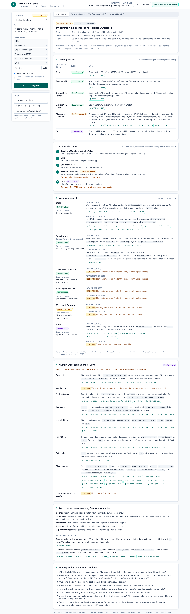
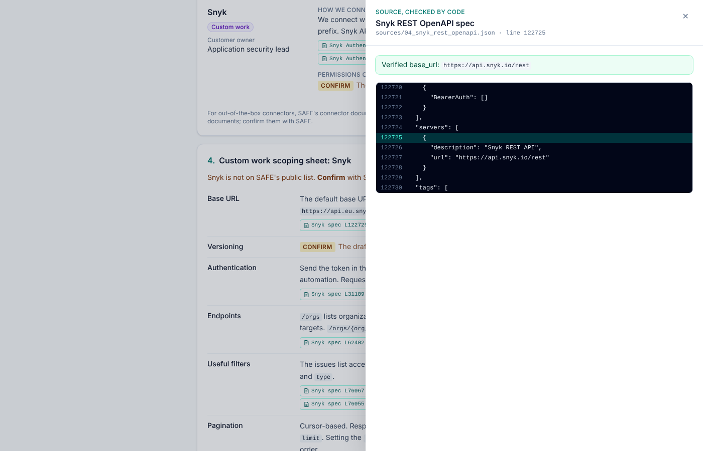
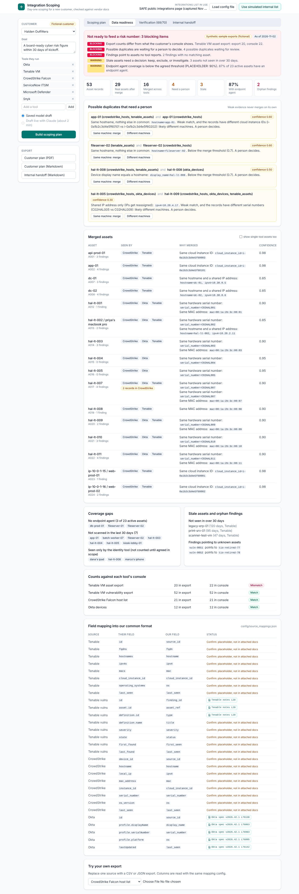
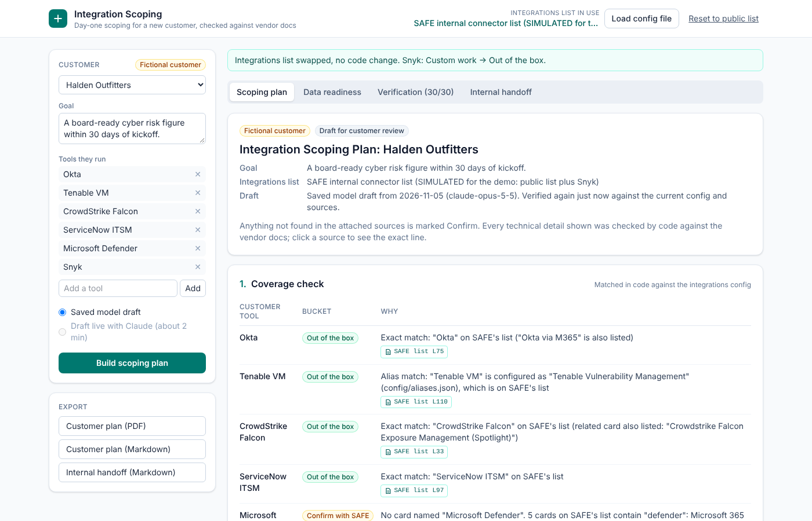

# Integration Scoping

A tool a Forward Deployed Engineer could use on day one with a new customer. You enter the customer's tools and goal, and it produces a one-page scoping plan the customer can sign off on:

- **Coverage:** which tools SAFE connects to out of the box, which need confirming, and which would be custom work.
- **Connection order:** what to connect first, and what each connection unlocks for the goal.
- **Access checklist:** what access is needed, and from whom on the customer side.
- **Data checks:** what we check before the data feeds a risk number.
- **Open questions:** what we still need to ask the customer.

It also runs those data checks on sample exports. That means mapping each tool's records into one common format, finding the same machine across tools, and flagging stale assets, coverage gaps, orphan findings and count mismatches.

**Everything here is a proof of concept.** The customer (Halden Outfitters) is fictional, the exports are synthetic, and the only sources are public vendor docs plus SAFE's public integrations page.

## The rule that matters: code checks, the model drafts

| Done by code | Done by the model (Claude) |
|---|---|
| Matching tools to the integrations list | Wording of each access and scoping item |
| Choosing which items exist, and which are Confirm | Rewording the "what this unlocks" sentences |
| The connection order (rules in config) | Rewording the open questions |
| Verifying every endpoint, parameter, field, scope, header, rate limit and version against the attached specs and docs | Proposing extra notes and questions (also verified) |
| Duplicate detection, staleness, coverage, counts, the readiness gate | Nothing |

Every fact the model writes comes with a citation (file plus line). The verifier then checks it:
- **Spec facts** (endpoints, parameters, response fields, OAuth scopes, auth schemes, base URLs) are checked against an index of the OpenAPI spec.
- **Doc facts** (rate limits, permissions, versions, header formats) must be quoted exactly, and the quote must exist at that line of the file.
- **The wording itself** is scanned for code-like tokens and numbers. Each one must be backed by a verified fact in the same item.

If anything fails, the whole item is held back and shown as **Confirm**. The model never gets a second try at "fixing" it. Tools with no vendor docs on file (CrowdStrike and ServiceNow here) always show Confirm, never a guess. This is the same citation-check pattern as [Supplier Command Center](https://github.com/PranavCR01/supplier-command-center).

The large specs (Okta at about 4 MB, Snyk at about 5 MB) are indexed at build time (`npm run index`). The model only sees a few endpoints that code retrieves from the index, never the full spec.

## Day one: swap in SAFE's own files, no code change

Every SAFE-specific input is a config file:

| File | What it holds | Today it contains |
|---|---|---|
| `config/integrations.json` | Connector list used for the coverage check | SAFE's public page (105 cards) |
| `config/aliases.json` | How customers write tool names | "Tenable VM" means "Tenable Vulnerability Management" |
| `config/matching.json` | Ambiguity rules (route variants, bare vendor names) | "via M365" is a route; bare "ServiceNow" is ambiguous |
| `config/tool_profiles.json` | Role, customer owner, and which vendor docs are on file per tool | Okta, Tenable, Snyk docs |
| `config/connection_order.json` | Ordering rules per goal, and gates for unconfirmed tools | Draft rules |
| `config/scoping_template.json` | Plan sections, access items, custom sheet items, standard questions | Based on the example plan |
| `config/canonical_schema.json` | The common asset and finding format | Small, modeled loosely on OCSF |
| `config/source_mappings.json` | How each tool's export maps to the common format | Okta and Tenable vuln fields verified; others are placeholders |
| `config/match_rules.json` | When two records are the same machine, with confidence values | Instance ID, serial, MAC, hostname plus IP, weak rules |
| `config/data_rules.json` | Staleness window, coverage definitions, readiness gate | Placeholder thresholds |
| `config/effort_placeholders.json` | Effort per bucket | "TBD", labelled as placeholders |

To use SAFE's internal versions, replace a file with one of the same shape and rebuild. In the running app you can also click **Load config file** (or **Use simulated internal list**) to swap the integrations list live. The plan updates and highlights what moved. The simulated list is the public list plus Snyk, so Snyk moves from Custom work to Out of the box and its custom scoping sheet disappears. Adding vendor docs for a new tool means dropping the files in `sources/` and pointing `config/tool_profiles.json` at them.

## What it does not do

- **It doesn't know SAFE's connectors.** It makes no claims about SAFE's internal systems, connector framework or data model. "Not on the public list" means "Custom work, confirm with SAFE", never "SAFE can't do it".
- **It doesn't guess for tools without docs.** CrowdStrike and ServiceNow access details are Confirm because no vendor docs for them are attached.
- **It doesn't estimate effort.** Effort comes from a config file and is labelled as a placeholder.
- **The token check has a blind spot.** It catches code-like tokens and numbers, not technical claims written purely as plain English words. Those rely on the prompt rule and on a person reading the draft.
- **Several field names are placeholders.** The Tenable asset export and CrowdStrike field names in the sample data are not documented in the attached files. They show as "Confirm: placeholder" in the app.
- **It doesn't use real customer data.** Halden Outfitters is fictional and the exports are synthetic.

## Results (proof of concept, not a benchmark)

Run `npm run eval` to regenerate [`docs/EVAL.md`](docs/EVAL.md). These come from public docs, a fictional customer, and synthetic data I designed:
- **Planted errors in the model draft:** 18/18 caught. The planted errors include fake endpoints, a wrong method, fake parameters and fields, a fake scope, a real scope on the wrong endpoint, a wrong header, a wrong rate limit, an invented quote, a wrong version, a wrong base URL, a wrong source file, and unbacked tokens and numbers in the wording. On the unmodified saved draft, 69/70 facts verify. One row (Snyk versioning) was held back because the model tagged a header name as a version. That's a real, unplanted hold, explained in the eval.
- **Coverage buckets:** 11/11 test cases land in the expected bucket. Every one of the 105 cards matches itself (a bare vendor name such as "ServiceNow" goes to Confirm by design), and any tool absent from the list lands in Custom work.
- **Duplicate detection on the synthetic data:** 0 wrong merges. Every same-machine pair that wasn't merged automatically went to the review queue for a person.

## Run it

```bash
npm install
```

```bash
npm test
```

```bash
npm run dev
```

Then open http://localhost:5173. The app uses the saved model draft in `fixtures/drafts/halden.json` by default, so no API key is needed. Every load re-verifies that draft against the current config and sources.

To draft live with Claude:

```bash
ANTHROPIC_API_KEY=... ALLOW_LIVE_DRAFT=1 npm run dev
```

To refresh the saved draft (one model call, about 2 minutes):

```bash
ANTHROPIC_API_KEY=... npm run draft -- halden
```

Other scripts: `npm run eval` writes `docs/EVAL.md`, and `npx tsx scripts/export-md.ts` writes sample exports to `docs/sample/`.

## Deploy (Vercel)

Import the repo in Vercel. The settings come from `vercel.json`: the build command is `npm run build`, which also builds the spec index, and the API functions live in `/api`. No environment variables are needed for the saved-draft demo.

Live drafting is off by default. On a public URL anyone could trigger model calls on your key. To turn it on, set `ANTHROPIC_API_KEY` and `ALLOW_LIVE_DRAFT=1`.

## Layout

```
config/            all SAFE-specific inputs (see table above)
sources/           the attached public docs (verification ground truth)
data/halden/       synthetic exports + truth.json (planted cases)
fixtures/drafts/   saved model draft
prompts/           versioned drafting prompt
src/core/          pure logic: coverage, ordering, verifier, plan assembly, data checks, export blocks
src/server/        file loading, spec retrieval, model call, HTTP handler
src/client/        React UI, PDF export
api/               Vercel functions (thin wrappers over src/server/http.ts)
tests/             verifier (planted errors), coverage, data, config swap
```

## Changes to the example plan (05_example_scoping_plan.md) after checking the sources

- **CrowdStrike and vulnerabilities:** CrowdStrike Falcon was listed as a source of vulnerabilities. SAFE's list has a separate "Crowdstrike Falcon Exposure Management (Spotlight)" card, and no attached doc says the base Falcon product supplies vulnerability data. The plan now asks whether the customer uses Spotlight.
- **Defender card count:** Five cards contain "Defender", not four. File 01 also says six ServiceNow variants, but there are seven cards. The tool counts these in code.
- **"Tenable VM" match type:** It is an alias match, not an exact one. "Tenable Security Center" is also listed, so a bare "Tenable" is ambiguous.
- **Tenable permissions:** The listed permissions come from the vulnerability export page. Permissions for the asset export are not in the notes, so they show as Confirm.
- **Snyk Bearer tokens:** The docs say Bearer tokens are for Snyk Apps. Automation uses a service account token with `Authorization: token`.

## Screenshots

| Scoping plan | Citation drawer |
|---|---|
|  |  |
| **Data readiness** | **Day-one config swap** |
|  |  |

Sample exports: [customer plan (Markdown)](docs/sample/halden-scoping-plan.md), [customer plan (PDF)](docs/sample/halden-scoping-plan.pdf), [internal handoff](docs/sample/halden-internal-handoff.md).
